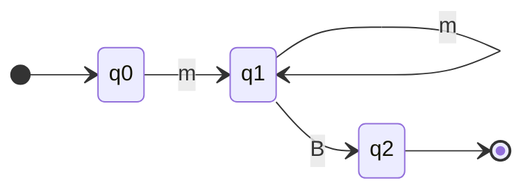
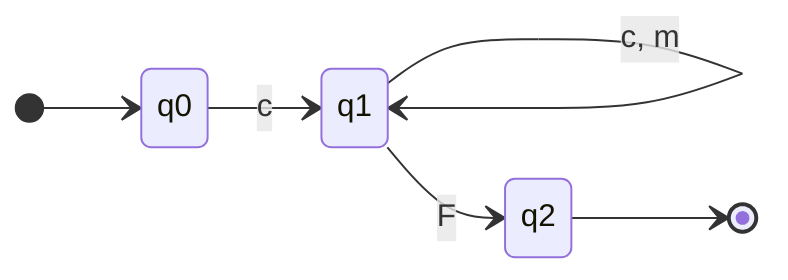
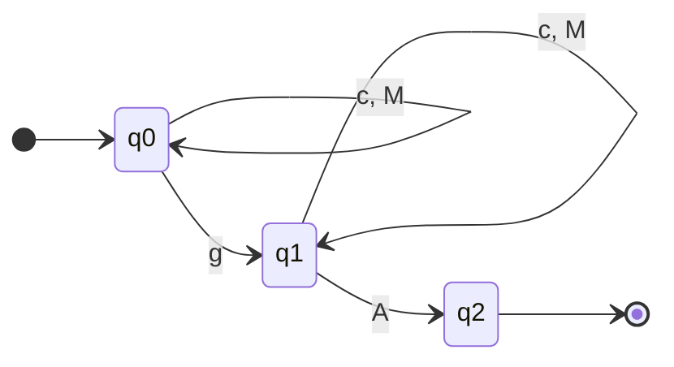
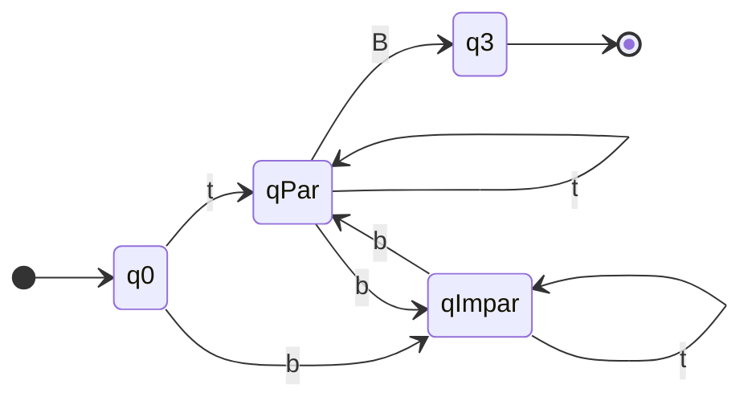
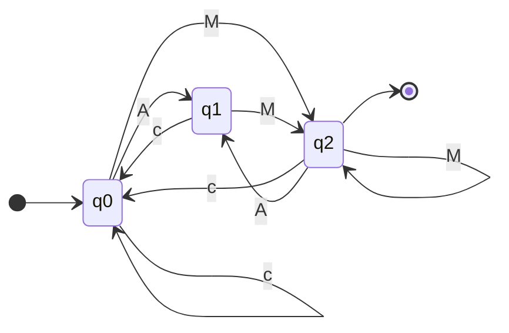

# Projeto Taverna

> Trabalho de **Linguagens Formais**: uma aplicação/jogo que aplica conceitos de **Autômatos Finitos Determinísticos (AFD)**.

## 1. Conceito

Você é o **barman de uma taverna anã**. Cada anão pede um drink, e **cada receita é um AFD**. Montar um drink é escrever uma **cadeia** sobre o alfabeto de ingredientes e ações. Se o autômato termina em um **estado final**, o drink é aceito; caso contrário, o anão reclama (ou pior).

O jogador nunca lê "autômato" na tela como teoria: ele **vê o grafo da receita**, monta a cadeia e acompanha o estado atual acendendo no grafo a cada ingrediente. O conceito é aprendido jogando.

### Mapeamento jogo ↔ teoria

| Jogo                                | Linguagens Formais                      |
| ----------------------------------- | --------------------------------------- |
| Ingredientes e ações                | Alfabeto Σ                              |
| Drink montado na caneca             | Cadeia w ∈ Σ*                           |
| Receita                             | AFD M = (Q, Σ, δ, q0, F)                |
| Etapa do preparo                    | Estado q ∈ Q                            |
| "Próximo passo" da receita          | Função de transição δ(q, a)             |
| Drink pronto para servir            | Estado final (q ∈ F)                    |
| Drink estragado sem volta           | Estado de erro / poço (dead state)      |
| Todas as variações válidas do drink | Linguagem aceita L(M)                   |
| Processar a caneca inteira          | Função de transição estendida δ*(q0, w) |

## 2. Universo do jogo

### Alfabeto Σ

Convenção: **minúsculas = ingredientes**, **maiúsculas = ações**. |Σ| = 9.

| Símbolo | Nome         | Tipo        | Sabor (flavor text)                                               |
| ------- | ------------ | ----------- | ----------------------------------------------------------------- |
| `t`     | Bactris      | Ingrediente | Fruto de palmeira espinhosa, trazido por mercadores da superfície |
| `b`     | Bagas        | Ingrediente | Bagas vermelhas das cavernas rasas                                |
| `g`     | Cogumelos    | Ingrediente | Cogumelo luminoso das minas profundas                             |
| `c`     | Cevada Negra | Ingrediente | Base de toda cerveja anã que se preze                             |
| `m`     | Mel          | Ingrediente | Mel de abelhas de rocha, raríssimo                                |
| `B`     | Bater        | Ação        | Agita a caneca com força                                          |
| `M`     | Mexer        | Ação        | Mexe devagar com colher de ferro                                  |
| `A`     | Aquecer      | Ação        | Leva a caneca à forja                                             |
| `F`     | Fermentar    | Ação        | Deixa descansar no barril                                         |

**Servir** não é símbolo: é o botão que submete a cadeia ao autômato.

### Personagens

- **Anões clientes**: cada um com nome, aparência e personalidade (afeta só as falas de feedback). Ex.: *Borin Barbaferro*, *Dagna Martelo-Rubro*, *Thrain, o Ranzinza*.
- **Taverneiro (jogador)**: nunca aparece, a câmera é a visão de trás do balcão.

## 3. Gameloop

1. **Chega um anão** e faz o pedido (nome do drink + fala).
2. **A receita aparece** como grafo do AFD no quadro da parede.
3. **Você monta 3 drinks diferentes** que sigam a receita (3 cadeias distintas, todas aceitas).
   - A cada símbolo clicado, o estado atual **acende** no grafo e a aresta usada pisca.
   - Se cair no estado de erro, a caneca fica verde/fumegante: dá para esvaziar e recomeçar.
4. **Você serve** cada drink (botão Servir).
5. **O anão reage** a cada drink:
   - Aceito e inédito: bebe, comemora, paga moedas.
   - Aceito mas repetido: "Já bebi esse, quero outro!" (não conta).
   - Rejeitado parado em estado não final: "Tá faltando coisa aí, rapaz!"
   - Rejeitado no estado de erro: "Isso é mijo de elfo!" e cospe.
6. Após 3 drinks aceitos e distintos, o anão sai satisfeito. Próximo cliente.

### Regras

- **Capacidade da caneca**: máximo de 8 símbolos. Mantém as cadeias curtas e evita laços infinitos óbvios.
- **Paciência**: cada anão tolera até 3 drinks rejeitados. Estourou, ele vai embora bravo (perde reputação).
- **Pontuação**: moedas por drink aceito; bônus se os 3 drinks usarem caminhos diferentes no grafo (incentiva explorar laços e ramificações).

## 4. Receitas (AFDs)

Cada receita ensina um conceito novo. O estado de erro `qx` existe em todas, mas é omitido nos diagramas: **toda transição não desenhada vai para `qx`**, e `qx` vai para ele mesmo com qualquer símbolo.

### Progressão

| Nível     | Drink                   | Linguagem                                                | Conceito ensinado         |
| --------- | ----------------------- | -------------------------------------------------------- | ------------------------- |
| 1         | Hidromel do Mineiro     | `m+B`                                                    | Sequência e laço          |
| 2         | Cerveja Negra de Khazad | `c(c\|m)*F`                                              | Escolha dentro do laço    |
| 3         | Grogue do Cogumelo      | exatamente um `g` sobre {c, g, M}, terminando em `A`     | Contagem exata            |
| 4         | Licor de Bagas          | número par de `b` sobre {t, b}, terminando em `B`        | Paridade (memória finita) |
| 5         | Fúria de Durin          | sobre {c, A, M}, sem `AA` consecutivo, terminando em `M` | Proibição de padrão       |
| 6 (bônus) | O Anão do Contra        | complemento de uma receita anterior                      | Complemento de AFD        |

### Nível 1: Hidromel do Mineiro

"Mel, quanto mais melhor, e uma boa batida no final."



**Definição formal:** M = (Q, Σ, δ, q0, F)

- Q = {q0, q1, q2, qx}
- Σ = {t, b, g, c, m, B, M, A, F}
- q0 = estado inicial
- F = {q2}

| δ | m | B | demais |
|---|---|---|---|
| → q0 | q1 | qx | qx |
| q1 | q1 | q2 | qx |
| * q2 | qx | qx | qx |
| qx | qx | qx | qx |

- Aceitas: `mB`, `mmB`, `mmmB`
- Rejeitadas: `B` (para em qx), `m` (para em q1, não final), `mBm` (qx), `mcB` (qx)

### Nível 2: Cerveja Negra de Khazad

"Começa com cevada, pode adoçar ou engrossar à vontade, e fermenta."



- Aceitas: `cF`, `cmF`, `ccmF`
- Rejeitadas: `mcF`, `cmm`, `cFF`

### Nível 3: Grogue do Cogumelo

"Um cogumelo. UM. Dois e você acorda em Valfenda."



- Aceitas: `gA`, `cgA`, `cMgcA`
- Rejeitadas: `cA` (nenhum g), `gcgA` (dois g)

### Nível 4: Licor de Bagas

"Bagas sempre aos pares, senão azeda."



- Aceitas: `tB`, `bbB`, `btbB`
- Rejeitadas: `bB`, `bbbB`

### Nível 5: Fúria de Durin

"Esquenta, mas nunca duas vezes seguidas, ou a caneca derrete."



Leitura dos estados: `q0` = último foi cevada (ou início), `q1` = acabou de aquecer, `q2` = acabou de mexer. `A` em `q1` vai para `qx`.

- Aceitas: `cM`, `cAM`, `AMAM`
- Rejeitadas: `cAAM`, `cA`

### Nível 6 (bônus): O Anão do Contra

Pede "qualquer coisa, **menos** Hidromel". O AFD é o **complemento** do nível 1 (troca F por Q \ F, incluindo `qx` como final). Mostra na prática que o estado de erro é obrigatório para o complemento funcionar.

## 5. GUI

Resolução base **320x180** (pixel art), escalada por inteiro (x4 = 1280x720) com `image-rendering: pixelated`.

```
+--------------------------------------------------------------+
|  [QUADRO DA RECEITA: grafo do AFD]        [ANÃO + balão fala] |
|   (q0)--m-->(q1)--B-->((q2))                                  |
|           ^__m__|                          Paciência: ♥ ♥ ♥   |
|--------------------------------------------------------------|
|  CANECA (cadeia):  [m][m][B][ ][ ][ ][ ][ ]   Estado: q2 ✔    |
|  Drinks servidos:  [mB ✔] [mmB ✔] [   ]                       |
|--------------------------------------------------------------|
|  BALCÃO:  🍇b  🌴t  🍄g  🌾c  🍯m   |  Bater Mexer Aquecer Ferm |
|           [Desfazer] [Esvaziar]            [ SERVIR ]         |
+--------------------------------------------------------------+
```

1. **Quadro da receita**: grafo do AFD (estados como círculos, finais com borda dupla, inicial com seta). Estado atual acende.
2. **Caneca**: a cadeia sendo montada, um slot por símbolo, com o estado atual ao lado.
3. **Balcão**: ingredientes e ações clicáveis (também por teclado, usando a própria letra do símbolo).
4. **Anão**: sprite, balão de fala, paciência.
5. **Histórico**: os drinks já servidos para este anão.

### Telas

- Título (logo da taverna, Jogar, Como jogar)
- Jogo (acima)
- Fim de turno: resumo de moedas e reputação
- Glossário opcional: explica o que é estado, transição, etc., ligando ao jogo

## 6. Tech

### Stack

- **Vite + TypeScript**, sem framework. O jogo cabe em DOM + SVG.
- **SVG** para o grafo do AFD (posições dos estados definidas à mão no JSON da receita, sem lib de layout).
- **DOM/CSS** para balcão, caneca e balões. Animações via CSS.
- **Sprites**: Reparoveitar sprites do Dev/dwarf-fortress-api/client e desenhe outros
- **Deploy**: GitHub Pages ou Vercel (site estático).

### Núcleo: o AFD

```ts
type AFD = {
  estados: string[];
  alfabeto: string[];
  inicial: string;
  finais: string[];
  delta: Record<string, Record<string, string>>; // ausente = qx
};

function executar(afd: AFD, cadeia: string[]) {
  const trilha = [afd.inicial];
  for (const s of cadeia) trilha.push(afd.delta[trilha.at(-1)!]?.[s] ?? "qx");
  const final = trilha.at(-1)!;
  return { aceita: afd.finais.includes(final), final, trilha };
}
```

A `trilha` alimenta tanto a animação no grafo quanto o tipo de feedback do anão (parou em `qx` vs. parou em estado não final).

### Formato de receita

```json
{
  "id": "hidromel",
  "nome": "Hidromel do Mineiro",
  "fala": "Mel, quanto mais melhor, e uma boa batida no final.",
  "afd": {
    "estados": ["q0", "q1", "q2"],
    "inicial": "q0",
    "finais": ["q2"],
    "delta": { "q0": { "m": "q1" }, "q1": { "m": "q1", "B": "q2" } }
  },
  "layout": { "q0": [20, 40], "q1": [80, 40], "q2": [140, 40] },
  "exemplos": { "aceitas": ["mB", "mmB"], "rejeitadas": ["B", "m", "mBm"] }
}
```

O teste `afd.test.ts` roda os `exemplos` de todas as receitas: se alguém errar um grafo, o teste quebra antes do jogo.

## 7. Arte (pixel art)

- **Paleta**: fixa e pequena para coesão, ex. [Endesga 32](https://lospec.com/palette-list/endesga-32) ou [Sweetie 16](https://lospec.com/palette-list/sweetie-16). Tons quentes (madeira, fogo, cobre).
- **Tamanhos**:

| Asset | Tamanho | Qtd |
|---|---|---|
| Ícones de ingrediente | 16x16 | 5 |
| Ícones de ação | 16x16 | 4 |
| Anões (busto, 2 frames: idle e reação) | 48x48 | 3 a 5 anões x 3 expressões (neutro, feliz, bravo) |
| Caneca (vazia, cheia, estragada) | 24x32 | 3 |
| Fundo da taverna (parede, barris, lareira) | 320x180 | 1 |
| Balcão | 320x48 | 1 |
| Quadro da receita (moldura) | ~160x90 | 1 |
| Estados do grafo (normal, atual, final) | 16x16 | 3 |
| Fonte bitmap | - | 1 (ex. m5x7, gratuita) |

- Animações curtas: anão bebendo, caneca borbulhando, poeira ao cuspir.
- Som (opcional): ambiente de taverna, "tum" ao bater, gole, arroto de aprovação.

## 8. Cronograma

> Ajustar ao prazo real da entrega.

| Semana | Entregas |
|---|---|
| 1 | Fechar alfabeto e as 6 receitas no papel (definição formal + exemplos). `afd.ts` + testes passando |
| 2 | UI funcional sem arte: grafo em SVG, caneca, balcão, gameloop completo com 1 anão |
| 3 | Pixel art, feedback dos anões, progressão de níveis, pontuação |
| 4 | Polimento, deploy, relatório e apresentação |

### Divisão sugerida

- **Lógica/AFD**: `afd.ts`, receitas, testes, relatório formal.
- **UI/Gameloop**: render do grafo, interação, telas.
- **Arte/Som**: sprites, paleta, animações.

## 9. Entregáveis do trabalho

- Jogo publicado (link) + repositório.
- **Relatório**: para cada receita, a 5-upla formal, tabela de transição, diagrama, linguagem descrita (em português e regex quando possível) e exemplos aceitos/rejeitados.
- Explicação de como o jogo simula δ* e decide aceitação.
- Apresentação com demo ao vivo.

## 10. Extras (se sobrar tempo)

- **Modo Mestre Cervejeiro**: o jogo dá cadeias aceitas e rejeitadas e o jogador **monta o autômato** (inverte o desafio).
- **Minimização**: receita "mal escrita" com estados redundantes; o jogador funde estados equivalentes.
- **Receita combinada**: drink que é a união/interseção de duas receitas (construção do produto).
- **Modo livre**: editor de receitas que exporta o JSON.

## 11. Questões em aberto

- [ ] Prazo exato da entrega e tamanho do grupo
- [ ] O professor exige alguma coisa específica no relatório (ex. minimização, prova)?
- [ ] "3 drinks diferentes" basta ser cadeias distintas, ou caminhos distintos no grafo?
- [ ] Mostrar o estado de erro `qx` no grafo ou mantê-lo implícito (decisão didática)?
